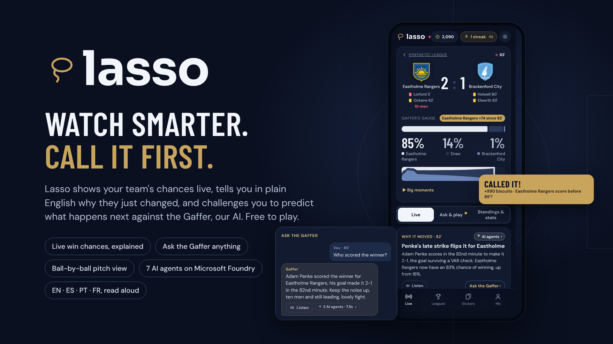
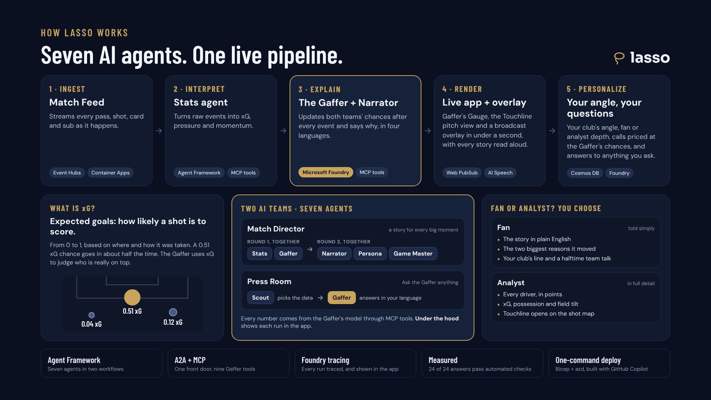
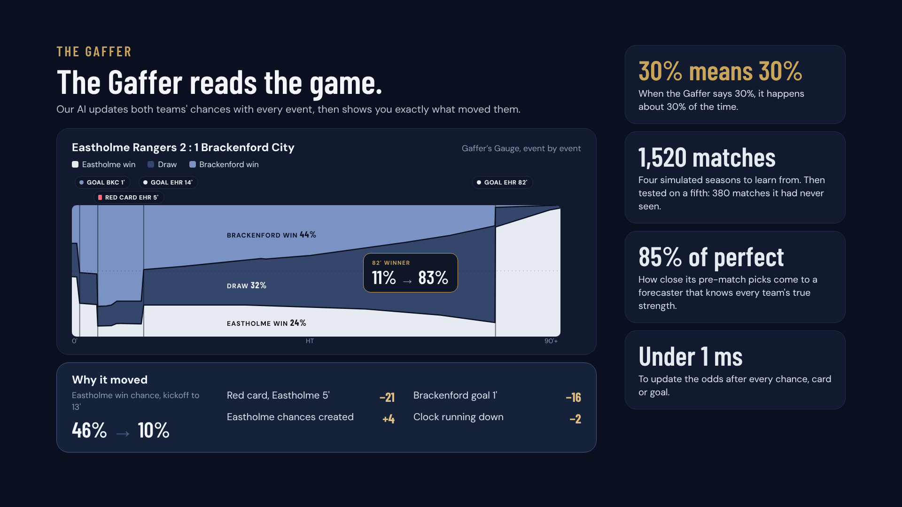
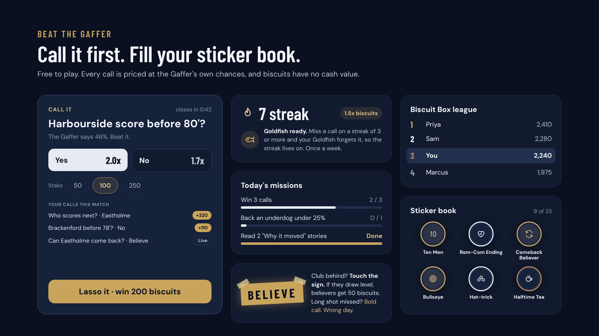
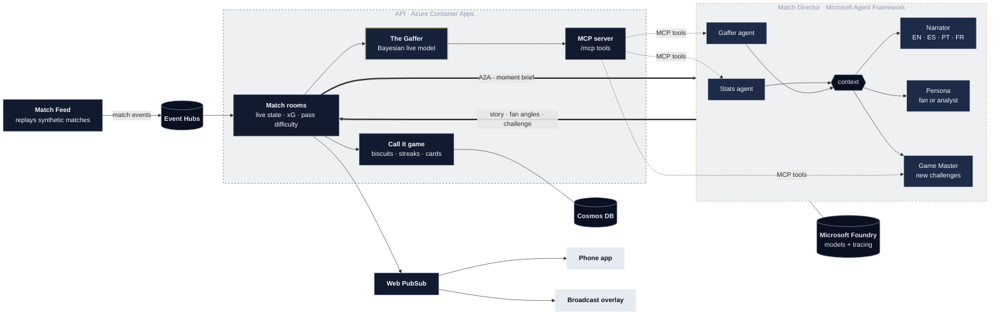
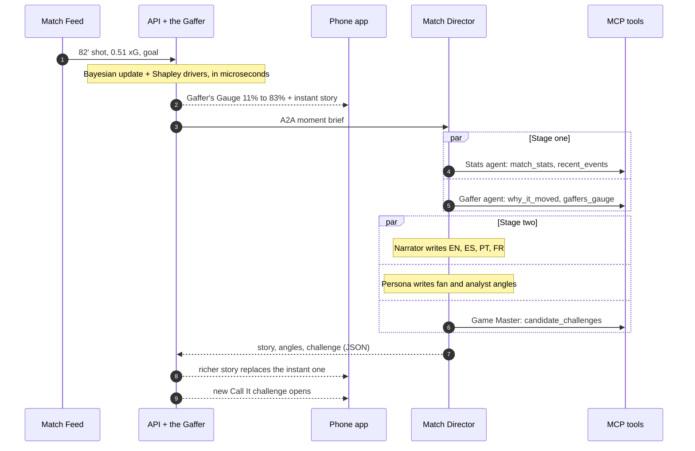
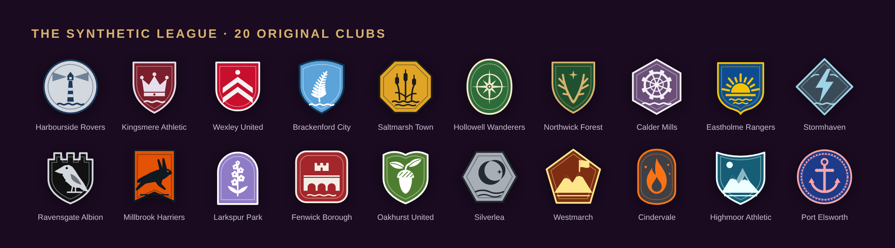

# Lasso: Believe Your Call

**See why the odds moved. Then out-predict the AI Gaffer on what's next.**

Lasso is a live, multi-agent match companion for phones and broadcasts, built for the Microsoft and Premier League *Inside the Game* hackathon.

- It ingests synthetic football events in real time.
- It updates a Bayesian win-probability model, **the Gaffer**, with every chance, card and goal. The model's output is the **Gaffer's Gauge**.
- It explains every swing, so fans know *why* it moved.
- **Touchline** shows the ball live on the pitch: every pass, shot, tackle, save and corner, with the move in progress and a whole-match shot map.
- It invites fans to make free-to-play **Call It** predictions against the Gaffer's own odds, with streaks, moment cards, missions and friend leagues. Biscuits are in-app points with no cash value.



<p>
  
  
  
</p>

## How it works



### What happens when a goal goes in

The Gaffer's Gauge and an instant story reach phones in under a second. The five agents' richer version follows a few seconds later, so the app never waits on a language model.



Here's how the code covers the brief's five stages:

| Stage | Where |
|---|---|
| **Ingest** | `services/api/lasso_api/feed.py`: the Match Feed replays synthetic matches into Event Hubs |
| **Interpret** | `matchroom.py` keeps live stats (xG, pass difficulty, field tilt, shot speed, momentum). The Stats agent picks out what matters |
| **Explain** | `engine/lasso_engine/inplay.py` (Bayesian live model) and `explain.py` (exact Shapley attribution). The Gaffer and Narrator agents turn those into words |
| **Render** | Realtime push to the mobile web app (`web/`): the Gaffer's Gauge, the Touchline live pitch, and a transparent broadcast overlay (`#/overlay/<match>`). Touchline's ball actions ride inside the Gauge updates, so they add no realtime messages |
| **Personalize** | Persona agent (fan or analyst depth, favorite-club lines), language choice, Game Master challenges, missions |

## The model, in numbers (held-out season; see the [model report](docs/model-report.md))

- **85%** of the best possible pre-match accuracy (ranked probability score against an oracle that knows the hidden true strengths)
- **1.5 points** average calibration error on the live Gaffer's Gauge
- **0.95 / 0.91** correlation between the estimated and the hidden true attack and defense strengths
- The fast Laplace posterior matches full NUTS MCMC (posterior means correlate at 0.99996)
- **2.2M** synthetic events across 1,900 matches and five seasons, with a hidden truth to evaluate against

### The league

Twenty fictional clubs, each with an original crest designed as one set: a distinct shape and emblem per club, in the club's own colors (generated by `web/scripts/make_crests.py`).



## Repository layout

| Path | What it is |
|---|---|
| `engine/` | `lasso_engine`: synthetic league and event simulator, the Gaffer (hierarchical Poisson team strengths plus Gamma-Poisson live updating), Shapley explanations, Call It pricing, evaluation |
| `services/api/` | FastAPI: match rooms, the game (biscuits, streaks, the Goldfish, cards, missions, leagues), the Gaffer **MCP server**, realtime hub, A2A client |
| `services/agents/` | **Microsoft Agent Framework** agents and the Match Director fan-out / fan-in workflow, hosted over **A2A**, on **Microsoft Foundry** models |
| `web/` | React + TypeScript phone app (installable PWA) and broadcast overlay |
| `infra/` | Bicep for the whole stack, deployed with `azd up`. Keyless managed identity throughout |
| `data/demo/` | The held-out season the app replays, plus the trained model |
| `docs/` | [Model report](docs/model-report.md), [deploy guide](docs/DEPLOY.md) |

## Quick start

Local, with no Azure needed:

```bash
pip install -e engine -r services/api/requirements.txt
(cd web && npm ci && npm run build)
(cd services/api && uvicorn lasso_api.main:app --port 8000)   # open http://localhost:8000
```

To deploy to Azure, see [docs/DEPLOY.md](docs/DEPLOY.md). The short version: `azd up`.

To regenerate the league and retrain the model:

```bash
cd engine
python -m lasso_engine.generate --out ../data/league --seed 7
python -m lasso_engine.training --data ../data/league --out ../data/model
python -m lasso_engine.evaluate --data ../data/league --model ../data/model --docs ../docs
python -m lasso_engine.export_demo
cd .. && python docs/charts/render_meter.py   # the showcase Gaffer's Gauge chart
```

## Responsible design

- **Free to play.** Biscuits have no cash value and cannot be bought. There's a daily top-up if you run out.
- **No real-world data.** All clubs, players and matches are synthetic, as the hackathon rules require.
- **Honest scoring.** The calibration bonus uses a proper scoring rule, so stating your true confidence is always your best strategy.
- **Cost guard-rails.** Agents only run for matches someone is watching, with a per-match gap and a daily cap.
