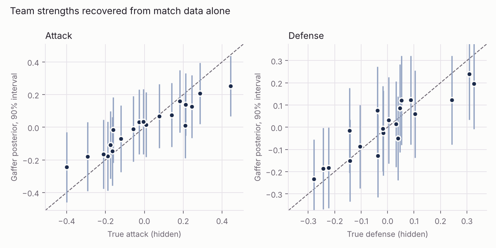
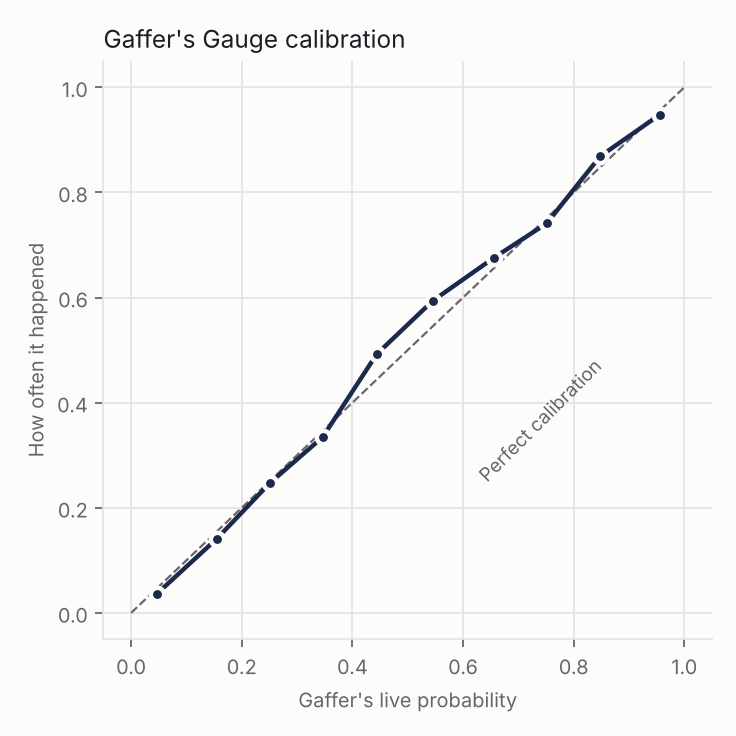
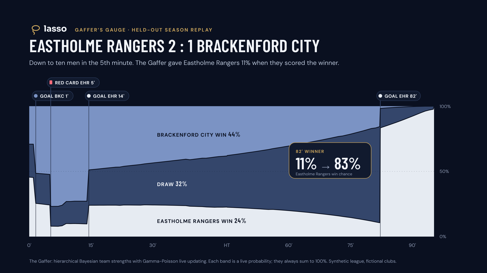

# The Gaffer: model report

All numbers come from `data/model/evaluation.json` and `data/model/mcmc_check.json`. You can reproduce them with:

```bash
cd engine
python -m lasso_engine.generate --out ../data/league --seed 7     # about 2 minutes
python -m lasso_engine.training --data ../data/league --out ../data/model
python -m lasso_engine.evaluate --data ../data/league --model ../data/model --docs ../docs
python -m lasso_engine.mcmc_check --data ../data/league --out ../data/model
cd .. && python docs/charts/render_meter.py
```

## 1. The synthetic league

- 20 fictional clubs and about 480 fictional players, over five seasons of double round-robin fixtures: 1,900 matches and about 2.2M events.
- The events are passes (with length, difficulty and ball speed), shots (with xG, body part and shot speed), saves, corners, tackles, interceptions, fouls, yellow and red cards, substitutions, and added time.
- Each club has a hidden **true** attack, defense, style and discipline, and these drift between seasons. Each match also has a hidden **form** factor for both teams, plus a half-time shift. All of this is written to `truth/`, which the model never reads.
- In-match game state follows realistic effects: a team down a man creates fewer chances, trailing teams push and leading teams sit back, and the pace rises late in the game.

The league is calibrated to league-wide top-flight averages:

| Metric per match | Lasso league (S1 to S5) | Target range |
|---|---|---|
| Goals | 2.70 to 2.90 | 2.6 to 2.9 |
| Home / draw / away | 41-45% / 25-28% / 28-34% | about 44 / 24 / 32 |
| Shots | 24.9 to 25.5 | about 25 |
| Pass completion | about 84% | 80 to 85% |
| Yellow / red cards | 4.3 / 0.17 | about 4 / 0.1 to 0.15 |

## 2. Pre-match model: hierarchical Poisson team strengths

`log λ_home = μ + H + att_home − def_away`, with Normal priors on the attack and defense terms. The likelihood blends goals with xG, and older matches are down-weighted with time decay. The posterior uses a Laplace approximation, which takes milliseconds per refit.

**Validated against full MCMC (NUTS, NumPyro).** Posterior means correlate at 0.99996, the largest difference in any mean is 0.006, and the median ratio of standard deviations is 1.001.

Held-out season 5 (380 matches), with the model refit before every matchday and no look-ahead:

| Forecast | RPS | Log loss |
|---|---|---|
| League base rates | 0.2256 | 1.077 |
| **Gaffer** | **0.2025** | **1.014** |
| Oracle (true hidden strengths) | 0.1982 | 0.999 |

The Gaffer captures **85% of the achievable improvement** over base rates. The remaining gap exists because the model has to learn strengths that the oracle is simply given.

**Strength recovery** at the end of season 5: correlation with the hidden truth is 0.95 for attack and 0.91 for defense, and the 90% credible intervals cover the truth for 90% and 100% of clubs respectively.



## 3. Live model: Gamma-Poisson updating

Each team's scoring rate is Gamma-distributed. The prior comes from the pre-match model, and in-match xG updates it conjugately against time exposure adjusted for game state. The goals still to come follow a Negative Binomial distribution, which gives closed-form win, draw and loss probabilities in microseconds.

The **game-state multipliers** are learned by Poisson regression on seasons 2 to 4:

| Effect | Learned | Hidden truth |
|---|---|---|
| Down a man | 0.62 | 0.68 |
| Up a man | 1.43 | 1.32 |
| Trailing | 1.08 | 1.16 |
| Leading | 0.94 | 0.87 |
| After 75' | 1.10 | 1.08 |

The learned score-state effects are pulled toward 1. That is a real confounder: teams that go behind tend to be the teams having an off day, so part of the "trailing" boost is cancelled out by their poor form. Production sports models face the same identification problem.

**Results on the held-out season:**

- **Calibration.** The average gap between the predicted probability and the observed frequency is **1.5 points**.
- **Goal forecasts** (what the "Call It" markets price). The held-out likelihood beats "score and clock only" by a log Bayes factor of **+33.7**, and it also beats a version without xG. Most of the gain comes in the second half, once there's enough in-match evidence.
- **Final-result accuracy.** It matches simpler models (Brier 0.437 against 0.437). Score and clock carry most of the result signal, and xG mostly sharpens the short-horizon goal questions.



## 4. Explanations: exact Shapley attribution

Each move of the Gaffer's Gauge is split across four parts: **goals, red cards, chances (xG) and the clock**. This uses exact Shapley values (16 model evaluations), and the parts sum exactly to the total change.

Example (Eastholme Rangers 2-1 Brackenford City, with Eastholme down to ten men from the 5th minute). Eastholme's win chance went from 46% at kickoff to 10% by the 13th minute:

| Part | Change |
|---|---|
| Red card | −21 pts |
| Goal conceded | −16 pts |
| Chances created | +4 pts |
| Clock | −2 pts |



## 5. Call It pricing

Payout multiplier = `floor((1 − 4%) / p, 0.1)`, bounded between 1.05x and 25x. A bonus based on the Brier score rewards honest confidence, so a player's best strategy is always to state what they really believe.
